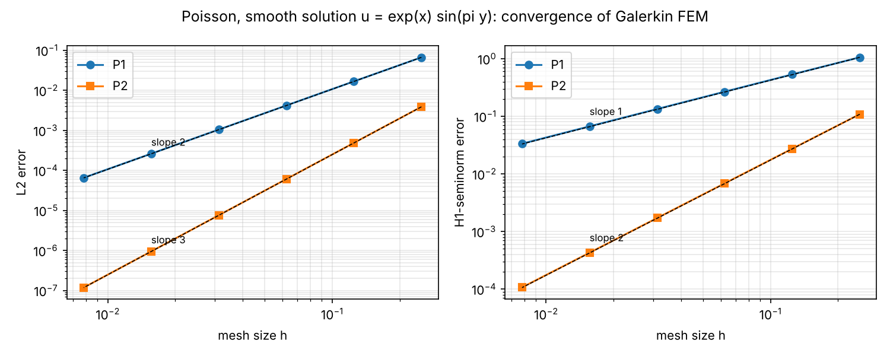
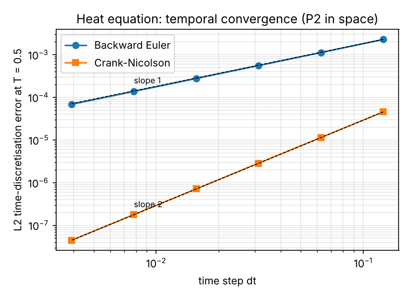
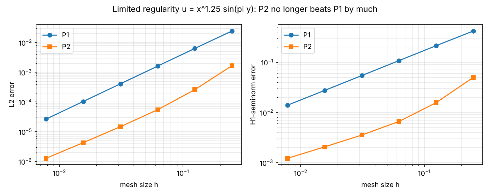

# Galerkin Finite Elements in Python: Poisson and Heat Equation on the Unit Square

A small, readable finite element code (NumPy/SciPy only) with P1 and P2 triangular elements,
written to **verify the method against manufactured smooth solutions** and to see
numerically how the convergence rates depend on the *regularity* of the solution.

## 1. From the strong form to the weak form

Strong form (Poisson problem with Dirichlet data):

    -Δu = f   in Ω = (0,1)²,        u = g   on ∂Ω.

1. Multiply by a test function v with v = 0 on ∂Ω and integrate over Ω:
   `-∫ Δu v dx = ∫ f v dx`.
2. Integrate by parts (divergence theorem):
   `∫ ∇u·∇v dx - ∫_∂Ω (∂u/∂n) v ds = ∫ f v dx`. The boundary term vanishes because v = 0 on ∂Ω.
3. **Weak form:** find u ∈ H¹ with u = g on ∂Ω such that
   `a(u,v) := ∫ ∇u·∇v dx = ∫ f v dx =: ℓ(v)` for all v ∈ H¹₀(Ω).
   Only first derivatives appear, so u needs less regularity than in the strong form.
   Dirichlet conditions are *essential* (built into the function space); flux conditions would be *natural* (they appear through the boundary term).
4. **Galerkin method:** replace H¹₀ by a finite-dimensional space V_h (continuous piecewise P1 or P2 polynomials).
   With the basis φ_j this gives the linear system `K U = F`, `K_ij = ∫ ∇φ_j·∇φ_i`, `F_i = ∫ f φ_i`.
5. **Heat equation** u_t − Δu = f: the same weak form gives `M U' + K U = F(t)` with the mass matrix `M_ij = ∫ φ_j φ_i`.
   Time stepping with the θ-method: θ = 1 is backward Euler, θ = ½ is Crank–Nicolson.

Expected rates for a smooth solution (Céa's lemma + interpolation estimates + Aubin–Nitsche duality):
P1: ‖u−u_h‖_L2 = O(h²), |u−u_h|_H1 = O(h);  P2: O(h³) and O(h²).

## 2. Code structure

| File | Content |
|---|---|
| `fem2d.py` | mesh, quadrature, P1/P2 basis, assembly of K, M and load vector, Dirichlet elimination, error norms, Poisson and heat solvers |
| `test_fem2d.py` | quadrature test, **patch test** (P1 and P2 reproduce a linear solution exactly), null space of K |
| `run_poisson_convergence.py` | spatial convergence, smooth solution |
| `run_heat_convergence.py` | temporal convergence (backward Euler vs Crank–Nicolson) |
| `run_nonsmooth_contrast.py` | contrast: solution with limited regularity |

Run: `pip install -r requirements.txt`, then `python test_fem2d.py` and the three `run_*.py` scripts.

## 3. Results

### 3.1 Poisson, smooth solution u = exp(x) sin(πy) (non-zero Dirichlet data)

| Element | N | dofs | L2 error | rate | H1 error | rate |
|---|---|---|---|---|---|---|
| P1 | 8 | 81 | 1.673e-02 | 1.99 | 5.336e-01 | 0.98 |
| P1 | 32 | 1089 | 1.047e-03 | 2.00 | 1.338e-01 | 1.00 |
| P1 | 128 | 16641 | 6.545e-05 | 2.00 | 3.347e-02 | 1.00 |
| P2 | 8 | 289 | 4.865e-04 | 2.99 | 2.738e-02 | 1.99 |
| P2 | 32 | 4225 | 7.608e-06 | 3.00 | 1.715e-03 | 2.00 |
| P2 | 128 | 66049 | 1.189e-07 | 3.00 | 1.072e-04 | 2.00 |

The measured rates agree with theory (2 and 1 for P1, 3 and 2 for P2). For the same number of degrees of freedom (about 16 600),
P2 is more than 50 times more accurate in L2 than P1 (9.5e-07 versus 6.5e-05). Full table: `results_poisson.csv`, plot: `convergence_poisson.png`.

### 3.2 Heat equation, u = exp(−t) exp(x) sin(πy), T = 0.5, P2 in space (N = 48)

Time error measured against a reference solution with the same spatial discretisation and a very small time step.

| Scheme | Δt = 0.0625 | Δt = 0.0156 | Δt = 0.0039 | observed order |
|---|---|---|---|---|
| Backward Euler | 1.117e-03 | 2.752e-04 | 6.852e-05 | 1.00 |
| Crank–Nicolson | 1.140e-05 | 7.127e-07 | 4.458e-08 | 2.00 |

The spatial error floor of this mesh is 1.4e-06 (total L2 error against the exact solution with tiny Δt). Plot: `convergence_heat.png`.

### 3.3 Contrast: limited regularity, u = x^1.25 sin(πy)

This u lies in H^s only for s < 1.75, and f is singular at x = 0.

| Element | N | L2 error | rate | H1 error | rate |
|---|---|---|---|---|---|
| P1 | 128 | 2.677e-05 | 1.97 | 1.395e-02 | 0.98 |
| P2 | 128 | 1.277e-06 | 1.76 | 1.224e-03 | 0.76 |

P1 keeps its optimal rates (it needs only H²-type regularity), but P2 drops from (3, 2) to about (1.75, 0.75), which is the limit set by the regularity of u.
**Higher-order elements pay off only when the solution is smooth.** Plot: `convergence_nonsmooth.png`.

## 4. Limitations and possible extensions

- Structured triangular meshes on the unit square only; extend to unstructured meshes (e.g. from `meshio`/Gmsh).
- Scalar problems only; natural next steps are linear elasticity (vector-valued, tensor-valued stresses) and the Stokes problem with Taylor–Hood elements.
- Compare the heat-equation results with my ADI finite-difference solver: https://github.com/Mintesinot-A/Python-ADI-Heat-Transfer
